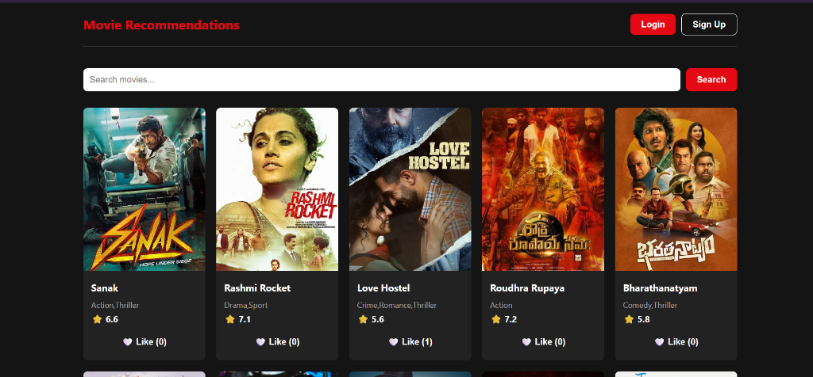
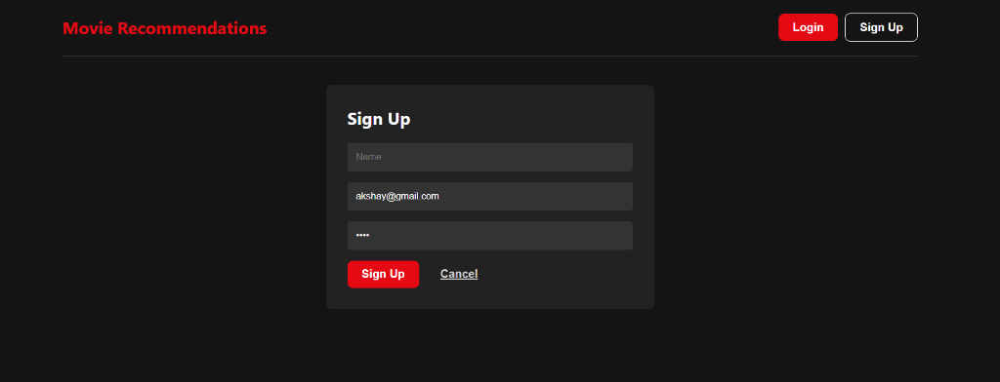
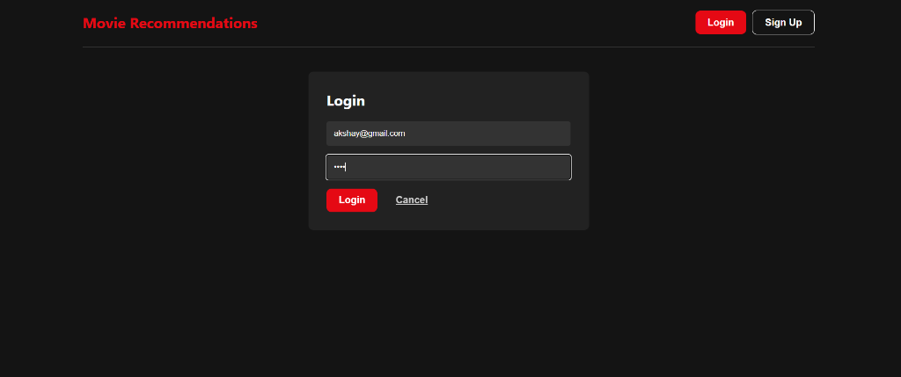
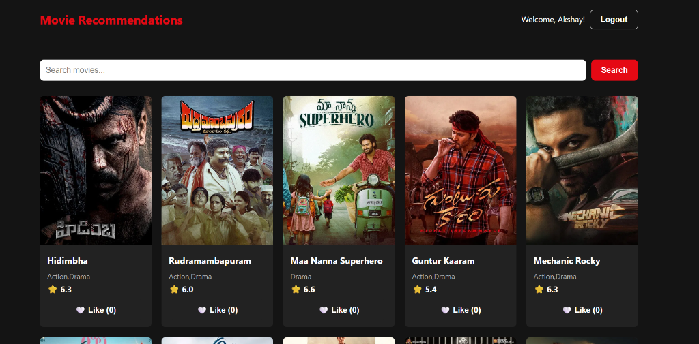
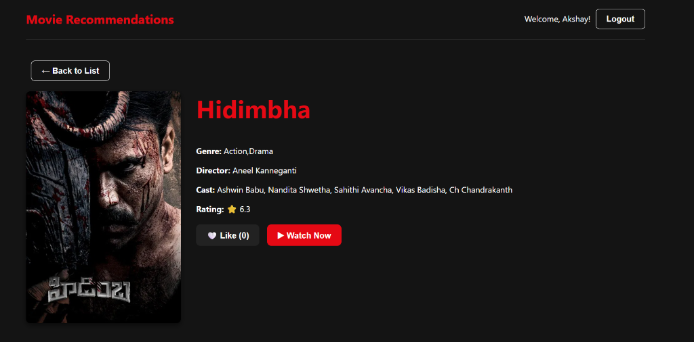
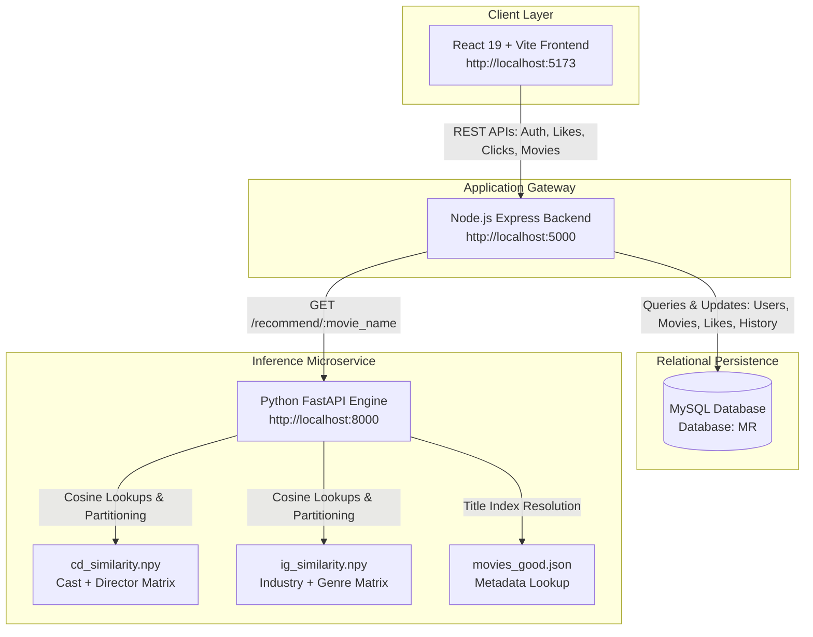

# 🎬 Movie Recommendation System

[](https://react.dev/)
[](https://vitejs.dev/)
[](https://nodejs.org/)
[](https://fastapi.tiangolo.com/)
[](https://www.mysql.com/)
[](https://numpy.org/)
[](LICENSE)

An end-to-end, full-stack **Movie Recommendation Platform** designed to deliver tailored movie suggestions in real time. The system couples a sleek, Netflix-inspired dark UI with an event-driven Express.js API, backed by a high-throughput Python **FastAPI** machine learning microservice that performs **dual-matrix cosine similarity ranking** across thousands of titles.

---

## 📌 Table of Contents

- [Overview](#-overview)
- [Key Features](#-key-features)
- [User Interface Showcase](#-user-interface-showcase)
- [System Architecture](#-system-architecture)
- [Recommendation Engine Deep Dive](#-recommendation-engine-deep-dive)
  - [Dual Similarity Matrices](#1-dual-similarity-matrices)
  - [Vector Search & Top-K Retrieval](#2-vector-search--top-k-retrieval)
  - [Hybrid Fusion & Deduplication](#3-hybrid-fusion--deduplication)
  - [Implicit Behavioral Feedback Loop](#4-implicit-behavioral-feedback-loop)
- [Database Schema](#-database-schema)
- [Project Directory Structure](#-project-directory-structure)
- [Getting Started & Installation](#-getting-started--installation)
  - [Prerequisites](#prerequisites)
  - [1. Database Setup](#1-database-setup)
  - [2. Machine Learning Service (FastAPI)](#2-machine-learning-service-fastapi)
  - [3. Backend API (Node.js/Express)](#3-backend-api-nodejsexpress)
  - [4. Frontend Application (React/Vite)](#4-frontend-application-reactvite)
- [API Reference](#-api-reference)
- [Future Enhancements](#-future-enhancements)
- [License](#-license)

---

## 🌟 Overview

The **Movie Recommendation System** solves the movie discovery challenge by blending **content-based filtering** with **implicit user feedback**. Users can explore movies across multiple industries (Tollywood, Bollywood, Hollywood), search dynamically with server-side pagination, inspect detailed cast/director metadata, like their favorite movies, and simulate movie watching.

When a user logs in, the platform monitors their recent behavior (watched titles, likes, and clicked movies) to adaptively remodel the home feed with hyper-relevant recommendations.

---

## ✨ Key Features

- **Personalized Home Feed**: Dynamically shifts movie suggestions based on the user's latest interaction (watch history, likes, and detail clicks).
- **Dual-Factor ML Engine**: Blends *Cast & Director* similarity with *Genre & Industry* affinity for balanced, high-accuracy suggestions.
- **Microservice Design**: Independent Python FastAPI microservice dedicated to vector operations, enabling ultra-low latency inference.
- **Interactive Movie Cards**: Displays IMDb-style ratings, genres, and live toggleable like counts.
- **Detailed Movie View**: In-depth view covering synopsis, director, full cast roster, streaming simulation, and a dedicated "Recommended Movies" carousel.
- **Real-Time Search**: Query titles dynamically with paginated results and search-audit logging.
- **Lightweight Authentication**: User signup and login session persistence stored via secure local browser states.

---

## 🖼️ User Interface Showcase

### 1. Home Catalog & Search
A rich, dark-themed catalog interface showing popular titles, search filters, genres, ratings, and like counters.



---

### 2. User Authentication (Sign Up & Login)
Clean modal interfaces for user onboarding and authentication.

| User Sign Up | User Login |
| :---: | :---: |
|  |  |

---

### 3. Personalized Recommendation Feed
Once logged in, the application greets the user and tailors the feed according to their most recent activities.



---

### 4. Movie Details & Watch Simulation
Inspect full metadata (Genre, Director, Cast, Rating) with actions to like, watch, and trigger contextual recommendations.



---

## 🏗️ System Architecture

The platform follows a modern, decoupled microservice pattern separating client rendering, business orchestration, analytical data storage, and machine learning inference:



### Component Breakdown:
1. **Frontend (`/frontend`)**: Built with React 19 and Vite. Manages client state, handles user interactions, renders modals, and executes debounced searches.
2. **Backend API (`/backend`)**: Express.js server functioning as the core gateway. Handles authentication, database connection pooling via `mysql2/promise`, activity logging, and proxying recommendation requests.
3. **ML Microservice (`/ML`)**: Standalone FastAPI service running via Uvicorn. Loads precomputed vector similarity representations directly into memory for sub-millisecond retrieval.
4. **Database (`/database`)**: MySQL instance storing tables for user credentials, movie catalog metadata, search queries, like interactions, and watch logs.

---

## 🧠 Recommendation Engine Deep Dive

The recommendation system implements a **multi-faceted Content-Based Filtering** strategy designed to overcome common recommendation pitfalls (e.g., recommending movies solely based on a genre while ignoring cast chemistry or directorial style).

```
                           +---------------------------+
                           |     Input Seed Movie      |
                           +-------------+-------------+
                                         |
                   +---------------------+---------------------+
                   |                                           |
                   v                                           v
       +-----------------------+                   +-----------------------+
       |   cd_similarity.npy   |                   |   ig_similarity.npy   |
       |  (Cast & Director)    |                   |  (Industry & Genre)   |
       +-----------+-----------+                   +-----------+-----------+
                   |                                           |
                   v                                           v
       +-----------------------+                   +-----------------------+
       | Top-20 Candidates     |                   | Top-20 Candidates     |
       | via np.argpartition   |                   | via np.argpartition   |
       +-----------+-----------+                   +-----------+-----------+
                   |                                           |
                   +---------------------+---------------------+
                                         |
                                         v
                           +---------------------------+
                           | Hybrid Fusion & De-dup    |
                           +-------------+-------------+
                                         |
                                         v
                           +---------------------------+
                           | Final Recommendations List|
                           +---------------------------+
```

### 1. Dual Similarity Matrices
Two pre-trained vector spaces represent different dimensions of cinematic affinity:
- **`cd_similarity.npy` (Cast + Director Similarity)**:
  Encodes actor pairings and directorial signatures using cosine similarity over bag-of-words / TF-IDF representations of directors and cast members. Captures stylistic consistency (e.g., Rajamouli or Christopher Nolan projects) and frequent collaborator dynamics.
- **`ig_similarity.npy` (Industry + Genre Similarity)**:
  Encodes thematic classifications, linguistic/regional cinema traditions (Tollywood, Bollywood, Kollywood, Hollywood), and genre blends (e.g., Action-Thriller vs. Romantic-Comedy).

### 2. Vector Search & Top-K Retrieval
Sorting large $N \times N$ similarity matrices ($O(N \log N)$) is computationally prohibitive on request paths. This engine utilizes **`numpy.argpartition`**:

```python
# Extract precomputed similarity row for the seed title
distances = cd_similarity[movie_index]

# Linear-time partial partition of top 21 candidates: O(N)
top_indices = np.argpartition(distances, -21)[-21:]

# Exact sort restricted to the top 21 subset: O(K log K)
top_indices = top_indices[np.argsort(distances[top_indices])[::-1]]
```
This guarantees response latency under **15 milliseconds**.

### 3. Hybrid Fusion & Deduplication
The API executes simultaneous lookups on both matrices:
1. Gathers the top 20 candidates from the Cast/Director vector space.
2. Gathers the top 20 candidates from the Industry/Genre space.
3. Excludes the seed title itself.
4. Performs a set union to eliminate duplicate results while retaining diversity across both dimensions.

### 4. Implicit Behavioral Feedback Loop
Personalization occurs without requiring users to fill out explicit rating forms. The system aggregates user activity across three signals:

$$\text{User Activity} = \text{Watch History} \cup \text{Likes} \cup \text{Clicks}$$

```sql
SELECT m.name FROM movies m 
JOIN (
    SELECT movie_id, watched_at AS action_time FROM watch_history WHERE user_id = ?
    UNION ALL
    SELECT movie_id, liked_at AS action_time FROM likes WHERE user_id = ?
    UNION ALL
    SELECT movie_id, clicked_at AS action_time FROM clicks WHERE user_id = ?
) AS combined ON m.id = combined.movie_id
ORDER BY action_time DESC LIMIT 1;
```
The most recent interaction title is used as an automatic seed to generate the personalized feed upon next visit. If no activity exists, the system gracefully falls back to a randomized exploration catalog (`ORDER BY RAND()`).

---

## 🗄️ Database Schema

The relational database (`MR`) is modeled to track user engagement and enforce referential integrity:

| Table | Description | Key Columns |
| :--- | :--- | :--- |
| **`users`** | User credentials and profile | `id` (PK), `name`, `email` (Unique), `password`, `gender`, `age` |
| **`movies`** | Catalog of movies | `id` (PK), `name`, `poster`, `genre`, `industry`, `director`, `cast`, `rating` |
| **`likes`** | User likes on movie titles | `id` (PK), `user_id` (FK), `movie_id` (FK), `liked_at` |
| **`clicks`** | Detailed view inspections | `id` (PK), `user_id` (FK), `movie_id` (FK), `clicked_at` |
| **`watch_history`**| Streaming / watch history | `id` (PK), `user_id` (FK), `movie_id` (FK), `watched_at` |
| **`user_searches`** | Audit trail of search queries | `id` (PK), `user_id` (FK), `searches`, `searched_at` |

---

## 📁 Project Directory Structure

```plaintext
Movie_Recommendation_System_main_project/
├── backend/
│   ├── .env.example          # Sample environment variables for Node.js
│   ├── index.js              # Express REST API server & database pool
│   ├── package.json          # Node backend dependencies
│   └── package-lock.json
├── database/
│   └── schema.sql            # MySQL schema setup & table definitions
├── docs/
│   └── screenshots/          # Application screenshots & UI demos
│       ├── 01_home_catalog.png
│       ├── 02_user_signup.png
│       ├── 03_user_login.png
│       ├── 04_personalized_recommendations.png
│       └── 05_movie_details.png
├── frontend/
│   ├── public/               # Static assets
│   ├── src/
│   │   ├── assets/           # UI graphics
│   │   ├── App.css           # Styling & design system tokens
│   │   ├── App.jsx           # Main React component
│   │   ├── index.css         # Global base styles
│   │   └── main.jsx          # React DOM entry point
│   ├── index.html            # Vite HTML template
│   ├── package.json          # React dependencies
│   └── vite.config.js        # Vite build configuration
├── ML/
│   ├── .env.example          # Sample environment variables for data insertion
│   ├── api.py                # FastAPI recommendation endpoints
│   ├── cd_similarity.npy     # Cast + Director cosine similarity matrix
│   ├── ig_similarity.npy     # Industry + Genre cosine similarity matrix
│   ├── insert_movie_data.js  # Batch population script for movies into MySQL
│   ├── main.py               # Local testing & debugging script
│   ├── movies_good.json      # Structured dataset with full movie metadata
│   ├── predict.py            # CLI-based recommendation invocation
│   └── support.py            # Matrix loader & index mappings
├── .gitignore                # Git exclusions (dependencies, .env, caches)
└── README.md                 # Complete project documentation
```

---

## 🚀 Getting Started & Installation

Follow these instructions to run the entire project locally on your machine.

### Prerequisites
- **Node.js**: v18.0.0 or higher
- **Python**: v3.9 or higher
- **MySQL Server**: v8.0 or higher
- **Git**

---

### 1. Database Setup

1. Open MySQL CLI or MySQL Workbench:
   ```bash
   mysql -u root -p
   ```
2. Execute the schema script:
   ```sql
   source /path/to/database/schema.sql;
   ```
   *(Or copy and execute the queries from `database/schema.sql` directly).*

3. Populate the `movies` table from the dataset:
   ```bash
   cd ML
   npm install
   cp .env.example .env
   # Update .env with your MySQL credentials (DB_USER, DB_PASSWORD, DB_NAME=MR)
   node insert_movie_data.js
   ```
   *Expected output: `XXXX movies inserted successfully!`*

---

### 2. Machine Learning Service (FastAPI)

1. Navigate to the `ML` directory:
   ```bash
   cd ML
   ```
2. Create and activate a Python virtual environment:
   ```bash
   # Windows
   python -m venv venv
   .\venv\Scripts\activate

   # Linux / macOS
   python3 -m venv venv
   source venv/bin/activate
   ```
3. Install required packages:
   ```bash
   pip install fastapi uvicorn numpy pandas
   ```
4. Start the FastAPI recommendation microservice:
   ```bash
   uvicorn api:app --host 0.0.0.0 --port 8000 --reload
   ```
   *The ML service will be available at: `http://localhost:8000` (Swagger docs at `http://localhost:8000/docs`).*

---

### 3. Backend API (Node.js/Express)

1. Open a new terminal and navigate to `backend`:
   ```bash
   cd backend
   ```
2. Install dependencies:
   ```bash
   npm install
   ```
3. Configure the environment variables:
   ```bash
   cp .env.example .env
   ```
   Edit `.env` to match your local MySQL configuration:
   ```ini
   DB_HOST=localhost
   DB_USER=root
   DB_PASSWORD=your_mysql_password
   DB_NAME=MR
   ```
4. Start the Express server:
   ```bash
   node index.js
   ```
   *The backend server will run on: `http://localhost:5000`.*

---

### 4. Frontend Application (React/Vite)

1. Open a new terminal and navigate to `frontend`:
   ```bash
   cd frontend
   ```
2. Install dependencies:
   ```bash
   npm install
   ```
3. Launch the Vite development server:
   ```bash
   npm run dev
   ```
4. Open your browser and navigate to `http://localhost:5173`.

---

## 📡 API Reference

### 🔐 Authentication

| Method | Endpoint | Request Body | Description |
| :--- | :--- | :--- | :--- |
| `POST` | `/auth/signup` | `{ name, email, password, gender, age }` | Registers a new user |
| `POST` | `/auth/login` | `{ email, password }` | Authenticates existing user |

### 🎥 Movies & Exploration

| Method | Endpoint | Query Parameters | Description |
| :--- | :--- | :--- | :--- |
| `GET` | `/movies/list` | `page`, `userId` *(optional)* | Returns paginated movie catalog (personalized if user logged in) |
| `GET` | `/movies/` | `query`, `page`, `userId` *(optional)* | Searches movies by title with search logging |
| `GET` | `/movies/:id` | `userId` *(optional)* | Fetches single movie details and logs a click interaction |

### 🤖 Recommendations

| Method | Endpoint | Query Parameters | Description |
| :--- | :--- | :--- | :--- |
| `GET` | `/movies/:id/recommendations` | `userId` *(optional)* | Returns top recommendations for a specific movie via FastAPI |
| `GET` | `http://localhost:8000/recommend/{movie_name}` | *None* | Direct FastAPI microservice endpoint returning unique title matches |

### ❤️ Interactions & History

| Method | Endpoint | Request Body | Description |
| :--- | :--- | :--- | :--- |
| `POST` | `/movies/:id/like` | `{ userId }` | Toggles like status on a movie |
| `POST` | `/movies/:id/watch` | `{ userId }` | Records movie watch history event |

---

## 🔮 Future Enhancements

- [ ] **Collaborative Filtering**: Implement Matrix Factorization (SVD / ALS) to blend user-to-user rating patterns with content features.
- [ ] **JWT & Password Security**: Incorporate bcrypt password hashing and JSON Web Tokens for session verification.
- [ ] **Redis Caching**: Cache recommendation arrays and popular queries to further reduce database load.
- [ ] **Trailer Embeds**: Integrate YouTube Data API to embed movie trailers directly inside the movie details modal.
- [ ] **Watchlist Feature**: Allow users to curate and save personalized "Watch Later" lists.

---

## 📄 License

This project is licensed under the [MIT License](LICENSE).
